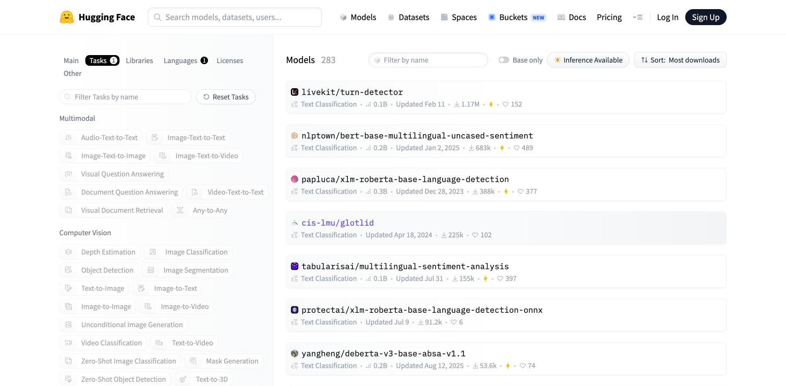
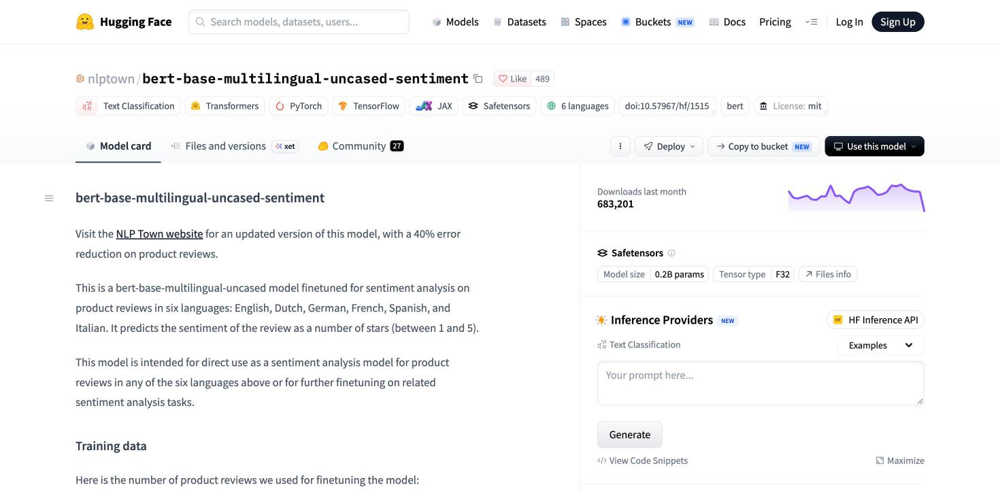
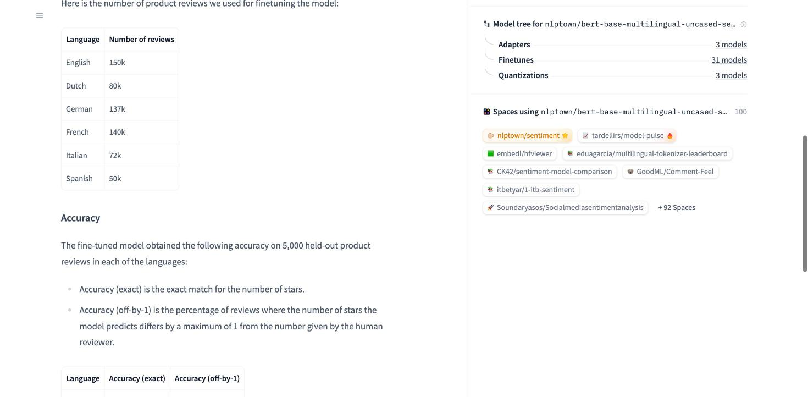

# Labo 1: klantberichten indelen als positief of negatief

Vandaag los je **één taak** op drie manieren op: is dit klantbericht van VeloBrux **positief of negatief**? Dat heet *sentiment analysis*. Eerst met regels, dan met een task-specific model (een model dat voor die ene taak getraind is, eerst bij Hugging Face en dan op je eigen laptop), dan met een groot taalmodel (LLM). Je evalueert de drie op dezelfde 12 gelabelde berichten. In de tweede les komen je functies achter een API met een kleine webpagina, en zet je twee modellen na elkaar in een cascade, getest op moeilijkere berichten.

**Zo werken we.** Alle code staat al in de repo. We overlopen ze samen, stukje per stukje, en jij voert ze uit. Daarna doe je een kleine aanpassing als **mini-oefening**. Je hebt telkens iets dat werkt. Klopt wat je ziet niet met **"Je ziet nu"**? Steek dan je hand op.

Let onderweg op de vier dingen uit de samenvatting van de les:

| Wat je moet onthouden | Waar je het ziet |
|---|---|
| Het model is maar één onderdeel | in `api.py` is elk model één regel; de webpagina errond is gewone software |
| Begin simpel | in `regels.py`: eerst een regel, als baseline voor de rest |
| Een model werkt met kansen | het sentimentmodel geeft een kans bij elk antwoord; de LLM antwoordt twee keer anders |
| Meten is weten | je evalueert alles op gelabelde data, ook op berichten die je nog niet zag |

**Dit is het eerste stuk van je portfolio.** Bewaar alles wat je vandaag maakt: je komt het op het einde van het semester mondeling toelichten.

---

## uv installeren

In AI Essentials werkte je in notebooks (Colab of Jupyter). Een echte applicatie is een **project**: een map met code, een lijst met packages en een vaste Python-versie. **uv** regelt dat.

**Windows** (PowerShell):

```powershell
powershell -ExecutionPolicy ByPass -c "irm https://astral.sh/uv/install.ps1 | iex"
```

**macOS / Linux**:

```bash
curl -LsSf https://astral.sh/uv/install.sh | sh
```

Sluit daarna je terminal en open een nieuwe. Dan:

```bash
uv --version
```

**Je ziet nu** iets als `uv 0.11.19`.

**Lukt het niet?** Staat er "uv wordt niet herkend" of "command not found"? Sluit écht alle terminals (ook die in VS Code) en open een nieuwe.

---

## De repo ophalen

Ga naar <https://github.com/orchardsol/ehb-ai-applications-labos> en klik rechtsboven op **Fork**. Dan heb je je eigen kopie op GitHub, onder je eigen naam. Daarin bewaar je al je werk: het is je portfolio.

Haal je fork naar je laptop (vervang `<jouw-gebruikersnaam>` door je GitHub-naam):

```bash
git clone https://github.com/<jouw-gebruikersnaam>/ehb-ai-applications-labos.git
cd ehb-ai-applications-labos
uv sync
```

`uv sync` installeert de juiste Python en alle packages, in een map `.venv` die alleen bij dit project hoort. De eerste keer duurt dat even: er zit onder andere PyTorch bij (± 500 MB).

| Commando | Wat doet het? |
|---|---|
| `uv sync` | alles installeren wat het project nodig heeft |
| `uv run ...` | iets uitvoeren in de omgeving van het project |

**Je sleutels.** Kopieer `.env.example` naar `.env` (Windows: `copy .env.example .env`). Daar komt straks je sleutel in, `OPENAI_API_KEY`, die je zelf aanmaakt met een gratis account. `.env` staat in `.gitignore`: **een sleutel hoort nooit in git.**

Open de repo in VS Code, vanuit de map `ehb-ai-applications-labos` waar je nu staat:

```bash
code .
```

(Werkt `code .` niet, open de map dan via *File → Open Folder*.) VS Code gebruikt dan vanzelf de Python uit `.venv`. Open in VS Code een terminal (*Terminal → New Terminal*) en ga naar de map van dit labo. Daar werk je de rest van de les:

```bash
cd labo-1
```

**Lukt het niet?** Zie je rode kronkellijnen onder `import openai`? Dan gebruikt VS Code een andere Python. Druk `Ctrl+Shift+P` (Mac: `Cmd+Shift+P`), kies **Python: Select Interpreter** en neem die met `.venv` erin.

**Je ziet nu** in de map `labo-1` deze bestanden. Die krijg je van ons:

| Bestand | Wat is het? |
|---|---|
| `berichten.csv` | gelabelde data: 12 klantberichten, elk met een label (`positief` of `negatief`) |
| `nieuwe_berichten.csv` | nog 12 gelabelde berichten. Open dit bestand nog niet: je hebt het nodig bij de regels |
| `hulp.py` | een hulpfunctie `evalueer()`, en ze leest je sleutels uit `.env` |
| `regels.py` | aanpak 1: een regel |
| `lokaal.py` | aanpak 2: een sentimentmodel van Hugging Face, op je eigen laptop |
| `sentimentmodel.py` | hetzelfde model via de API van Hugging Face (je docent toont het: vraagt een betaald account) |
| `taalmodel.py` | aanpak 3: een LLM, via een API |
| `lokaal_taalmodel.py` | een LLM op je eigen laptop, met Ollama |
| `api.py` en `web/` | een API en een webpagina, voor les 2 |

---

## Gelabelde data

Open `berichten.csv` en lees de 12 berichten. Achter elk bericht staat een **label**: het juiste antwoord, `positief` of `negatief`. Dat heet gelabelde data. Vandaag gebruik je ze om elke aanpak te evalueren.

**Denk na:** welke van de 12 berichten zijn moeilijk, en waarom?

---

## Regels

De simpelste aanpak: jij schrijft zelf de regel.

Open `regels.py`:

```python
from hulp import evalueer


def voorspel_met_regel(tekst):
    if "kapot" in tekst:
        return "negatief"
    return "positief"


evalueer(voorspel_met_regel)
```

- `from hulp import evalueer` haalt de functie `evalueer` uit het bestand `hulp.py`.
- `def voorspel_met_regel(tekst):` is de functie: een bericht erin, `"positief"` of `"negatief"` eruit.
- De regel zelf: staat het woord "kapot" in het bericht, dan is het negatief. Anders positief.
- `evalueer(voorspel_met_regel)` test je functie op de gelabelde data: ze roept je functie aan voor elk van de 12 berichten en vergelijkt het antwoord met het label. Dat is een **evaluatie**. (Ze tekent de tabel met de library `rich`; die code zit in `hulp.py`, je hoeft ze niet te kennen.)

```bash
uv run regels.py
```

**Je ziet nu**:

```text
voorspel_met_regel op berichten.csv
┏━━━━━━━━━━━━━━━━━━━━━━━━━━━━━━━━━━━━━━━━━━━━━━━━━━━━━━━━━━━━━━━┳━━━━━━━━━━━━┳━━━━━━━━━━┓
┃ bericht                                                       ┃ antwoord   ┃ label    ┃
┡━━━━━━━━━━━━━━━━━━━━━━━━━━━━━━━━━━━━━━━━━━━━━━━━━━━━━━━━━━━━━━━╇━━━━━━━━━━━━╇━━━━━━━━━━┩
│ De levering was super snel, top!                              │ positief ✓ │ positief │
│ Mijn fiets is al voor de derde keer kapot.                    │ negatief ✓ │ negatief │
│ Bedankt voor de snelle herstelling, alles werkt weer perfect. │ positief ✓ │ positief │
│ Ik wacht al drie weken op mijn terugbetaling.                 │ positief ✗ │ negatief │
│ Geweldig, alweer een week langer wachten op mijn batterij.    │ positief ✗ │ negatief │
│ Niet slecht, die nieuwe huurfietsen!                          │ positief ✓ │ positief │
│ Merci pour le service rapide, je suis très content.           │ positief ✓ │ positief │
│ Le vélo est encore en panne, c'est inadmissible.              │ positief ✗ │ negatief │
│ De monteur heeft me goed geholpen, ik kom zeker terug.        │ positief ✓ │ positief │
│ Ik heb twee keer betaald en niemand antwoordt op mijn mails.  │ positief ✗ │ negatief │
│ Eindelijk een winkel waar je niet moet wachten.               │ positief ✓ │ positief │
│ De fiets is prima, maar de factuur klopt weer niet.           │ positief ✗ │ negatief │
└───────────────────────────────────────────────────────────────┴────────────┴──────────┘
7/12 juist · 0.000 seconden per bericht
op je eigen laptop: 0.000 seconden CPU-tijd per bericht, 30 MB geheugen
```

Vijf berichten gaan fout (✗), en kijk naar welke: de regel kent maar één woord. De laatste regel toont wat het je eigen laptop kostte: CPU-tijd en geheugen. Bij een regel is dat bijna niets.

**Mini-oefening.** Voeg een tweede woord toe aan je regel en evalueer opnieuw:

```python
    if "kapot" in tekst or "wacht" in tekst:
```

Probeer nog een paar woorden. Hoe ver geraak je in drie minuten?

**En op berichten die je nog niet zag?** Je hebt je regel verbeterd terwijl je naar deze 12 berichten keek. In `nieuwe_berichten.csv` staan 12 andere gelabelde berichten. Voeg onderaan je bestand een regel toe en start opnieuw:

```python
evalueer(voorspel_met_regel, "nieuwe_berichten.csv")
```

**Je ziet nu** twee scores. Wat gebeurt er met je score op de nieuwe berichten?

Dat heet **overfitting**: je regel past goed op de data waarmee je hem maakte, en slechter op nieuwe data. Daarom evalueer je ook op gelabelde data die je bij het bouwen niet gebruikte. Die data heet de **testset**.

---

## Een sentimentmodel van Hugging Face

Een **task-specific model** is getraind voor één taak. Wij gebruiken er een dat het sentiment van een tekst inschat, van 1 tot 5 sterren. Iemand anders heeft het getraind, op productreviews in zes talen, en op [Hugging Face](https://huggingface.co) gezet. Jij draait het straks op je eigen laptop.

Hugging Face is de grootste verzameling open AI-modellen: meer dan een miljoen, van bedrijven, universiteiten en hobbyisten. Je kunt ze gratis downloaden, zonder account.

### Een model vinden

Ga naar <https://huggingface.co/models>. Links kun je filteren. Kies bij *Tasks* **Text Classification** (sentiment is een vorm van tekst classificeren) en bij *Languages* **Dutch**. Sorteer rechtsboven op *Most downloads*.



Er blijven een paar honderd modellen over. Bovenaan staat [`nlptown/bert-base-multilingual-uncased-sentiment`](https://huggingface.co/nlptown/bert-base-multilingual-uncased-sentiment), met 683.000 downloads per maand. Klik erop: je komt op de **model card**, de pagina van het model.



Voor je een model gebruikt, zoek je op de model card het antwoord op deze vragen:

- Waarop is het getraind, en waarvoor is het bedoeld? Dit model leerde van productreviews, niet van helpdeskmails. Dat staat in de tekst, met een tabel van de trainingsdata.
- Welke talen kent het? Dit model: Engels, Nederlands, Duits, Frans, Italiaans en Spaans. Zie de tag *6 languages* bovenaan.
- Mag je het gebruiken? Kijk naar de licentie, ook bovenaan. Dit model: *License: mit*, dus ja, ook commercieel.
- Hoe groot is het? Rechts: *Model size 0.2B params*, 167 miljoen parameters. Het bestand met het model is 669 MB.
- Hoe goed is het? Lager op de pagina staat de *Accuracy* die de makers zelf maten. Maar werkt het voor jouw taak? Dat weet je pas als je het evalueert op je eigen gelabelde data.



Rechts staat ook de *Model tree*: andere mensen hebben dit model verder getraind (*Finetunes*) of kleiner gemaakt (*Quantizations*). De knop *Use this model* toont de code om het model op je eigen computer te draaien. Daar komen we straks op terug.

**Via de API van Hugging Face.** Hugging Face kan dit model ook op zijn eigen servers draaien: jij stuurt een bericht, zij sturen de vijf kansen terug. Dat kost geld (sinds oktober 2026 zijn er geen gratis credits meer), dus je docent toont het in de les. De code staat in `sentimentmodel.py`. Je krijgt precies dezelfde kansen als straks op je laptop, maar je berichten gaan naar de servers van Hugging Face.

**Denk na:** wat als er een naam en een adres in die berichten stonden?

---

## Het sentimentmodel, op je eigen laptop

Bij een API gaan je berichten naar de aanbieder. Dit model is klein genoeg om het **lokaal** te draaien, op je eigen laptop:

| | Via een API (bij Hugging Face) | Zelf hosten (hier: op je laptop) |
|---|---|---|
| Wat gaat naar buiten? | elk bericht | niets |
| Wie rekent? | hun servers | jouw CPU en jouw geheugen |
| Kost | per vraag | niets per vraag; wel de machine waarop het draait |
| Snelheid | een request over het netwerk per bericht | geen netwerk |
| Zonder internet? | nee | ja |
| Opstarten | meteen | eerst het model downloaden; bij elke start het model in het geheugen laden |
| Wat moet je kennen? | één functie | de hele stack hieronder |

**Wat er op je laptop komt.** Een model lokaal draaien vraagt vier dingen, en het is goed om te weten wat elk ervan doet:

- **Hugging Face Hub**: de opslag. Daar staat het bestand met het model (`model.safetensors`, 669 MB: de 167 miljoen getallen) naast de model card.
- **Transformers**: de Python-library van Hugging Face. Ze weet hoe een model zoals BERT in elkaar zit, bevat de *tokenizer* die tekst omzet in getallen, en `pipeline()`, dat tekst → tokenizer → model → label aan elkaar knoopt. Dezelfde code werkt voor een miljoen modellen op de Hub. Documentatie: <https://huggingface.co/docs/transformers/index>.
- **PyTorch**: het ML-framework eronder. Transformers rekent zelf niet; ze zegt PyTorch wat er met de getallen moet gebeuren, en PyTorch doet dat op je CPU, of op een GPU als je er een hebt. (De tag *TensorFlow* op de model card is een ander framework; recente versies van Transformers werken alleen nog met PyTorch.)
- **Je laptop**: schijf voor het model, geheugen om het in te laden, een CPU om te rekenen.

`uv sync` installeerde Transformers en PyTorch al. Het model download je nu.

**Eerst kijken, in de REPL.** Een REPL is Python waarin je regel per regel typt en meteen het resultaat ziet, zoals een cel in een notebook. Start er een met `uv run python` en typ:

```python
from transformers import pipeline
model = pipeline("text-classification", model="nlptown/bert-base-multilingual-uncased-sentiment")
model("De levering was super snel, top!")
```

De tweede regel downloadt de eerste keer het model (669 MB) naar je schijf; dat duurt even. Daarna laadt ze het in het geheugen: een paar seconden, elke keer dat je programma start.

**Je ziet nu**:

```text
[{'label': '5 stars', 'score': 0.7397723197937012}]
```

Het model geeft "5 sterren" als beste antwoord, met een kans van 74%: de *confidence*. Precies dat getal krijg je ook via de API van Hugging Face: het is hetzelfde model, dezelfde 167 miljoen getallen. Wil je alle vijf de kansen, één per aantal sterren? Vraag ze:

```python
model("De levering was super snel, top!", top_k=None)
```

Verlaat de REPL met `exit()`.

**Dan de functie.** Open `lokaal.py`:

```python
from transformers import pipeline

from hulp import evalueer

MODEL = "nlptown/bert-base-multilingual-uncased-sentiment"
model = pipeline("text-classification", model=MODEL)


def voorspel_met_lokaal_model(tekst):
    resultaat = model(tekst)
    if resultaat[0]["label"] in ["4 stars", "5 stars"]:
        return "positief"
    return "negatief"


evalueer(voorspel_met_lokaal_model)
```

- `pipeline(...)` laadt het model, één keer, bij de start van je programma.
- `resultaat[0]["label"]` is het label met de hoogste kans. Vier of vijf sterren noemen wij positief, al de rest negatief.

```bash
uv run lokaal.py
```

**Je ziet nu**:

```text
voorspel_met_lokaal_model op berichten.csv
┏━━━━━━━━━━━━━━━━━━━━━━━━━━━━━━━━━━━━━━━━━━━━━━━━━━━━━━━━━━━━━━━┳━━━━━━━━━━━━┳━━━━━━━━━━┓
┃ bericht                                                       ┃ antwoord   ┃ label    ┃
┡━━━━━━━━━━━━━━━━━━━━━━━━━━━━━━━━━━━━━━━━━━━━━━━━━━━━━━━━━━━━━━━╇━━━━━━━━━━━━╇━━━━━━━━━━┩
│ De levering was super snel, top!                              │ positief ✓ │ positief │
│ Mijn fiets is al voor de derde keer kapot.                    │ negatief ✓ │ negatief │
│ Bedankt voor de snelle herstelling, alles werkt weer perfect. │ positief ✓ │ positief │
│ Ik wacht al drie weken op mijn terugbetaling.                 │ negatief ✓ │ negatief │
│ Geweldig, alweer een week langer wachten op mijn batterij.    │ positief ✗ │ negatief │
│ Niet slecht, die nieuwe huurfietsen!                          │ positief ✓ │ positief │
│ Merci pour le service rapide, je suis très content.           │ positief ✓ │ positief │
│ Le vélo est encore en panne, c'est inadmissible.              │ negatief ✓ │ negatief │
│ De monteur heeft me goed geholpen, ik kom zeker terug.        │ positief ✓ │ positief │
│ Ik heb twee keer betaald en niemand antwoordt op mijn mails.  │ negatief ✓ │ negatief │
│ Eindelijk een winkel waar je niet moet wachten.               │ positief ✓ │ positief │
│ De fiets is prima, maar de factuur klopt weer niet.           │ negatief ✓ │ negatief │
└───────────────────────────────────────────────────────────────┴────────────┴──────────┘
11/12 juist · 0.037 seconden per bericht
op je eigen laptop: 0.016 seconden CPU-tijd per bericht, 433 MB geheugen
```

Kijk naar de laatste regel: het model zit in het geheugen van jouw laptop (een paar honderd MB; via een API zou je programma ± 60 MB nemen) en jouw CPU doet het rekenwerk. Dat is het verschil tussen een API gebruiken en een model **zelf hosten**. Wie zelf host, moet de stack van hierboven installeren en onderhouden: versies die bij elkaar passen, het model downloaden en bij elke start laden, een nieuwe versie uitrollen als er een betere komt, en voor een groot model een GPU. Dat werk heet **MLOps**; we komen erop terug in blok 8. Dit is een licht model; bij een LLM gaat het om vele gigabytes.

**Kleiner maken: quantization.** Op de model card zag je onder *Model tree* drie *Quantizations*. Het model bestaat uit 167 miljoen getallen van elk 4 bytes: 669 MB. Rond je elk getal af tot 1 byte, dan blijft er 168 MB over. Dat heet **quantization**: je verliest een klein beetje precisie en wint een download die vier keer kleiner is, minder geheugen en meer snelheid. Zo draaien LLM's op een laptop of een gsm. Die kleinere versies staan in een ander formaat (ONNX) voor een andere runtime; de pipeline van Transformers laadt ze niet. Ook dat is een MLOps-keuze: welke versie van het model, op welke runtime.

**Mini-oefening.** Hoe zeker is het model van zijn fout? Start je bestand met `-i`: dan krijg je na het uitvoeren een REPL waarin `model` al bestaat.

```bash
uv run python -i lokaal.py
```

```python
model("Geweldig, alweer een week langer wachten op mijn batterij.", top_k=None)
```

**Nog een.** Zet je wifi uit en start `lokaal.py` opnieuw. Werkt het nog? Zet je wifi daarna weer aan.

---

## Een LLM

Het sentimentmodel kan één ding: sterren geven. Een LLM, een **foundation model**, kan je alles vragen: de taak zit in je **prompt**, niet in het model.

### Wie maakt de modellen?

| Aanbieder | Modellen | Open weights? |
|---|---|---|
| OpenAI (VS) | GPT-5: nano, mini, GPT-5 · gpt-oss | alleen gpt-oss |
| Google (VS) | Gemini: Flash-Lite, Flash, Pro · Gemma | alleen Gemma |
| Anthropic (VS) | Claude: Haiku, Sonnet, Opus | nee |
| Meta (VS) | Llama | ja |
| Mistral (Frankrijk) | Mistral Small, Medium, Large | deels |
| DeepSeek, Alibaba (China) | DeepSeek, Qwen | ja |

Stand oktober 2026; dit verandert om de paar maanden. **Open weights** betekent dat je het model kan downloaden en zelf hosten (via Hugging Face of Ollama). De andere huur je via een API.

**Een modelnaam lezen**, bijvoorbeeld `gemini-3.5-flash-lite`, `claude-haiku-4-5`, `gemma4:e4b`, `openai/gpt-oss-120b`:

- *familie en versie*: Gemini 3.5, Claude 4.5. Een nieuwe versie antwoordt anders, en de oude verdwijnt na een tijd.
- *grootte bij een API*: een tier. Flash-Lite < Flash < Pro, Haiku < Sonnet < Opus, nano < mini < GPT-5. Hoe groot precies, zeggen ze niet.
- *grootte bij open weights*: een getal, **B = miljard parameters**. Tot ongeveer 4B past op een laptop of gsm, 8 tot 30B vraagt een stevige laptop of één GPU, 70B en meer draait op servers. `26B-A4B`: 26 miljard parameters, waarvan 4 miljard actief per vraag.
- *type*: `-it` of `instruct` is getraind om instructies te volgen (chat); een **reasoning**-model denkt eerst en antwoordt dan (gpt-oss, Gemma 4); embedding-modellen zie je in blok 5; task-specific modellen zoals ons sentimentmodel.

Groter is beter, maar trager en duurder: kies het kleinste model dat je evaluatie haalt. We komen hierop terug telkens we een model kiezen.

### De OpenAI API

Elke aanbieder van LLM's heeft een web-API. OpenAI (het bedrijf achter ChatGPT) had als eerste een API die veel ontwikkelaars gebruikten, en de rest van de industrie heeft dat formaat grotendeels overgenomen: Google, Mistral, DeepSeek, Groq en ook Ollama (op je eigen laptop) aanvaarden dezelfde requests. Anthropic (Claude) heeft een eigen API, maar biedt ook een compatibel endpoint aan. Daarom gebruik je in dit vak de Python-library `openai`, ook voor modellen die niet van OpenAI komen. Je kiest de aanbieder met een `base_url` en het model met zijn naam; de rest van je code blijft gelijk.

| Aanbieder | `base_url` | model |
|---|---|---|
| Google AI Studio (vandaag) | `https://generativelanguage.googleapis.com/v1beta/openai/` | `gemini-3.5-flash-lite` |
| Groq (gratis, werkt ook) | `https://api.groq.com/openai/v1` | `openai/gpt-oss-120b` |
| Anthropic (compatibel endpoint) | `https://api.anthropic.com/v1/` | `claude-haiku-4-5` |
| Ollama (thuis, op je laptop) | `http://localhost:11434/v1` | `gemma4:e2b` |

De API bestaat uit een paar endpoints. Je hoeft ze niet van buiten te kennen, wel te weten dat ze bestaan:

| Endpoint | Wat doet het? | In dit vak |
|---|---|---|
| **chat completions** | je stuurt een gesprek (`messages`, elk bericht met een rol: `system`, `user` of `assistant`) en krijgt het volgende bericht van het model | vandaag, en bijna overal |
| **embeddings** | tekst wordt een lijst getallen waarmee je op betekenis kan zoeken | blok 5 |
| **audio, images** | spraak naar tekst, tekst naar spraak, beelden maken | één voorbeeld, later |
| **responses** | het nieuwere endpoint van OpenAI zelf, met ingebouwde tools; andere aanbieders volgen traag | blok 6 |

### Een sleutel bij Google AI Studio

Jouw sleutel komt van Google. Je kent Google AI Studio misschien al van AI Essentials; aanmelden gaat met hetzelfde Google-account als Colab. De free tier vraagt geen kredietkaart en volstaat voor dit labo: 15 requests per minuut voor het model dat wij gebruiken, en een limiet per dag.

1. Ga naar <https://aistudio.google.com> en meld je aan met je Google-account.
2. Klik op *Get API key* en dan *Create API key*. Geef de sleutel een naam en kopieer hem.
3. Zet hem in `.env`:

```text
OPENAI_API_KEY=AQ....
```

De naam `OPENAI_API_KEY` is wat de library `openai` leest; dat de sleutel van Google komt, maakt haar niet uit.

**Eerst kijken, in de REPL.** Start er opnieuw een met `uv run python` en typ regel per regel:

```python
import hulp
from openai import OpenAI
llm = OpenAI(base_url="https://generativelanguage.googleapis.com/v1beta/openai/")
vraag = "Antwoord als helpdesk in één zin: Mijn fiets is al voor de derde keer kapot."
antwoord = llm.chat.completions.create(model="gemini-3.5-flash-lite", messages=[{"role": "user", "content": vraag}])
antwoord.choices[0].message.content
```

- `OpenAI(base_url=...)` is de client, de verbinding met de aanbieder. `base_url` zegt naar welke aanbieder je requests gaan; je sleutel komt uit `.env`.
- `model` is welke LLM je wil. Gemini 3.5 Flash-Lite is het kleinste en snelste model van Google.
- `messages` is het gesprek: hier één bericht van de gebruiker, jouw prompt.
- `antwoord.choices[0].message.content` is de tekst die het model terugstuurt.

**Je ziet nu** één zin, bijvoorbeeld:

```text
'Wat vervelend om te horen, we gaan dit direct voor u oplossen en ik stuur u zo een e-mail voor een passende oplossing.'
```

**Stel dezelfde vraag nog eens.** Druk twee keer op pijltje omhoog om de regel met `llm.chat.completions.create` terug te halen, en vraag daarna opnieuw `antwoord.choices[0].message.content` op. Is de zin dezelfde als daarnet?

Kijk ook wat het kostte. Een LLM rekent per **token**, een stukje tekst:

```python
antwoord.usage.prompt_tokens, antwoord.usage.completion_tokens
```

Verlaat de REPL met `exit()`.

**Dan de functie.** Open `taalmodel.py`:

```python
import time

from openai import InternalServerError, OpenAI, RateLimitError

from hulp import evalueer

GOOGLE = "https://generativelanguage.googleapis.com/v1beta/openai/"
llm = OpenAI(base_url=GOOGLE, max_retries=0)
MODEL = "gemini-3.5-flash-lite"


def voorspel_met_taalmodel(tekst):
    prompt = "Is dit bericht positief of negatief? "
    prompt = prompt + "Antwoord met één woord.\n\n" + tekst
    try:
        antwoord = llm.chat.completions.create(
            model=MODEL,
            messages=[{"role": "user", "content": prompt}],
        )
    except (RateLimitError, InternalServerError):
        print("  Google antwoordt niet: 20 seconden wachten")
        time.sleep(20)
        return voorspel_met_taalmodel(tekst)
    woord = antwoord.choices[0].message.content
    return woord.lower().strip(" .")


evalueer(voorspel_met_taalmodel)
```

- De taak staat in gewone taal in de prompt, met het bericht erachter.
- De aanroep is dezelfde als in de REPL, nu in een `try`.
- Vraag je meer dan 15 keer per minuut, dan antwoordt Google niet met een antwoord maar met een fout: statuscode `429`, een **rate limit**. Elke API heeft er een. De library maakt daar een `RateLimitError` van. Soms is Google gewoon te druk en antwoordt het met `503`: dat wordt een `InternalServerError`. Jouw code vangt beide op: 20 seconden wachten en dezelfde vraag opnieuw stellen. (De library zou dat standaard zelf een paar keer proberen; met `max_retries=0` zetten we dat uit, zodat je het ziet gebeuren.)
- Een LLM geeft tekst terug, bijvoorbeeld `Negatief.` met een hoofdletter en een punt. De laatste regel van de functie maakt daar `negatief` van.

```bash
uv run taalmodel.py
```

**Je ziet nu**:

```text
voorspel_met_taalmodel op berichten.csv
┏━━━━━━━━━━━━━━━━━━━━━━━━━━━━━━━━━━━━━━━━━━━━━━━━━━━━━━━━━━━━━━━┳━━━━━━━━━━━━┳━━━━━━━━━━┓
┃ bericht                                                       ┃ antwoord   ┃ label    ┃
┡━━━━━━━━━━━━━━━━━━━━━━━━━━━━━━━━━━━━━━━━━━━━━━━━━━━━━━━━━━━━━━━╇━━━━━━━━━━━━╇━━━━━━━━━━┩
│ De levering was super snel, top!                              │ positief ✓ │ positief │
│ Mijn fiets is al voor de derde keer kapot.                    │ negatief ✓ │ negatief │
│ Bedankt voor de snelle herstelling, alles werkt weer perfect. │ positief ✓ │ positief │
│ Ik wacht al drie weken op mijn terugbetaling.                 │ negatief ✓ │ negatief │
│ Geweldig, alweer een week langer wachten op mijn batterij.    │ negatief ✓ │ negatief │
│ Niet slecht, die nieuwe huurfietsen!                          │ positief ✓ │ positief │
│ Merci pour le service rapide, je suis très content.           │ positief ✓ │ positief │
│ Le vélo est encore en panne, c'est inadmissible.              │ negatief ✓ │ negatief │
│ De monteur heeft me goed geholpen, ik kom zeker terug.        │ positief ✓ │ positief │
│ Ik heb twee keer betaald en niemand antwoordt op mijn mails.  │ negatief ✓ │ negatief │
│ Eindelijk een winkel waar je niet moet wachten.               │ positief ✓ │ positief │
│ De fiets is prima, maar de factuur klopt weer niet.           │ negatief ✓ │ negatief │
└───────────────────────────────────────────────────────────────┴────────────┴──────────┘
12/12 juist · 0.719 seconden per bericht
op je eigen laptop: 0.008 seconden CPU-tijd per bericht, 72 MB geheugen
```

Start het **meteen nog eens**. Nu zit je boven de 15 requests per minuut:

```text
  Google antwoordt niet: 20 seconden wachten
  Google antwoordt niet: 20 seconden wachten
  Google antwoordt niet: 20 seconden wachten
voorspel_met_taalmodel op berichten.csv
┏━━━━━━━━━━━━━━━━━━━━━━━━━━━━━━━━━━━━━━━━━━━━━━━━━━━━━━━━━━━━━━━┳━━━━━━━━━━━━┳━━━━━━━━━━┓
┃ bericht                                                       ┃ antwoord   ┃ label    ┃
┡━━━━━━━━━━━━━━━━━━━━━━━━━━━━━━━━━━━━━━━━━━━━━━━━━━━━━━━━━━━━━━━╇━━━━━━━━━━━━╇━━━━━━━━━━┩
│ De levering was super snel, top!                              │ positief ✓ │ positief │
│ Mijn fiets is al voor de derde keer kapot.                    │ negatief ✓ │ negatief │
│ Bedankt voor de snelle herstelling, alles werkt weer perfect. │ positief ✓ │ positief │
│ Ik wacht al drie weken op mijn terugbetaling.                 │ negatief ✓ │ negatief │
│ Geweldig, alweer een week langer wachten op mijn batterij.    │ negatief ✓ │ negatief │
│ Niet slecht, die nieuwe huurfietsen!                          │ positief ✓ │ positief │
│ Merci pour le service rapide, je suis très content.           │ positief ✓ │ positief │
│ Le vélo est encore en panne, c'est inadmissible.              │ negatief ✓ │ negatief │
│ De monteur heeft me goed geholpen, ik kom zeker terug.        │ positief ✓ │ positief │
│ Ik heb twee keer betaald en niemand antwoordt op mijn mails.  │ negatief ✓ │ negatief │
│ Eindelijk een winkel waar je niet moet wachten.               │ positief ✓ │ positief │
│ De fiets is prima, maar de factuur klopt weer niet.           │ negatief ✓ │ negatief │
└───────────────────────────────────────────────────────────────┴────────────┴──────────┘
12/12 juist · 5.914 seconden per bericht
op je eigen laptop: 0.011 seconden CPU-tijd per bericht, 72 MB geheugen
```

Dezelfde score, maar je wachtte een minuut. Zonder die `except` was je programma gewoon gecrasht. Code die rekening houdt met een dienst die nee zegt, heet een **fallback**; in uur 3 komen we erop terug.

**Mini-oefening.** Laat je functie tonen hoeveel tokens ze gebruikt: zet deze regel net vóór de `return`:

```python
    print(antwoord.usage.prompt_tokens, antwoord.usage.completion_tokens)
```

Hoeveel tokens kost één bericht ongeveer, in en uit? Noteer die twee getallen: je hebt ze straks nodig.

**Mini-oefening: een ander model.** Google host ook Gemma, zijn open model. Verander één regel en start opnieuw (wacht eerst een minuut):

```python
MODEL = "gemma-4-26b-a4b-it"
```

**Je ziet nu** 0 op 12, en elk antwoord begint met `<thought>`: het model denkt eerst hardop na, in het Engels, en zet dan pas `Positief` of `Negatief`, na `</thought>`. Dezelfde prompt, "antwoord met één woord", een ander model, een ander antwoord. Hoe goed een model instructies volgt (**instruction following**) verschilt per model, en je code moet daarmee om. Een tijdelijke oplossing: neem alleen wat na `</thought>` komt. Zet deze regel net vóór de `return`:

```python
    woord = woord.split("</thought>")[-1]
```

Dan haalt ook Gemma 12 op 12, maar wel in 4,5 seconden per bericht. In blok 3 leer je hoe je een model dwingt tot een vast formaat (structured output), zodat je dit soort regels niet nodig hebt. Zet `MODEL` daarna terug op `gemini-3.5-flash-lite`.

**Lukt het niet?** *`AuthenticationError`* of *`401`*: je sleutel ontbreekt in `.env` of klopt niet. Blijft het wachten op de rate limit? Dan zit je aan de limiet per dag; morgen gaat het weer, of vraag een extra sleutel aan je buur.

**Denk na:** je 12 berichten gingen nu naar de servers van Google, samen met je prompt. In de free tier mag Google wat je stuurt gebruiken om zijn producten te verbeteren (het staat in de voorwaarden). Wat als er een naam en een adres in een bericht stonden?

---

## Een LLM op je eigen laptop

[Ollama](https://ollama.com) draait LLM's met open weights op je eigen laptop. Het spreekt dezelfde OpenAI API, dus je code van daarnet werkt ook met een LLM op je laptop.

**Ollama installeren.** Heb je Ollama nog niet (of weet je het niet zeker: `ollama --version`)? Installeer het:

Windows (PowerShell):

```powershell
irm https://ollama.com/install.ps1 | iex
```

macOS / Linux:

```bash
curl -fsSL https://ollama.com/install.sh | sh
```

Liever klikken? Download `OllamaSetup.exe` (Windows) of `Ollama.dmg` (macOS) van <https://ollama.com/download>. Sluit daarna je terminal en open een nieuwe, en controleer met `ollama --version`.

Haal dan een heel klein LLM: Gemma 3 met 270 miljoen parameters, 291 MB.

```bash
ollama pull gemma3:270m
```

Open `lokaal_taalmodel.py`. Het is `taalmodel.py`, met een andere aanbieder en een ander model (en zonder de `except`: je eigen laptop heeft geen rate limit):

```python
from openai import OpenAI

from hulp import evalueer

OLLAMA = "http://localhost:11434/v1"
llm = OpenAI(base_url=OLLAMA, api_key="ollama")
MODEL = "gemma3:270m"


def voorspel_met_lokaal_taalmodel(tekst):
    prompt = "Is dit bericht positief of negatief? "
    prompt = prompt + "Antwoord met één woord.\n\n" + tekst
    antwoord = llm.chat.completions.create(
        model=MODEL,
        messages=[{"role": "user", "content": prompt}],
    )
    woord = antwoord.choices[0].message.content
    return woord.lower().strip(" .")


evalueer(voorspel_met_lokaal_taalmodel)
```

(Ollama vraagt geen sleutel, maar de library wil er een; `"ollama"` is goed.)

```bash
uv run lokaal_taalmodel.py
```

**Je ziet nu**:

```text
voorspel_met_lokaal_taalmodel op berichten.csv
┏━━━━━━━━━━━━━━━━━━━━━━━━━━━━━━━━━━━━━━━━━━━━━━━━━━━━━━━━━━━━━━━┳━━━━━━━━━━━━━━━┳━━━━━━━━━━┓
┃ bericht                                                       ┃ antwoord      ┃ label    ┃
┡━━━━━━━━━━━━━━━━━━━━━━━━━━━━━━━━━━━━━━━━━━━━━━━━━━━━━━━━━━━━━━━╇━━━━━━━━━━━━━━━╇━━━━━━━━━━┩
│ De levering was super snel, top!                              │ negatief ✗    │ positief │
│ Mijn fiets is al voor de derde keer kapot.                    │ negatief ✓    │ negatief │
│ Bedankt voor de snelle herstelling, alles werkt weer perfect. │ negatief ✗    │ positief │
│ Ik wacht al drie weken op mijn terugbetaling.                 │ negatief ✓    │ negatief │
│ Geweldig, alweer een week langer wachten op mijn batterij.    │ negatief ✓    │ negatief │
│ Niet slecht, die nieuwe huurfietsen!                          │ niet slecht ✗ │ positief │
│ Merci pour le service rapide, je suis très content.           │ positief ✓    │ positief │
│ Le vélo est encore en panne, c'est inadmissible.              │ negatief ✓    │ negatief │
│ De monteur heeft me goed geholpen, ik kom zeker terug.        │ negatief ✗    │ positief │
│ Ik heb twee keer betaald en niemand antwoordt op mijn mails.  │ negatief ✓    │ negatief │
│ Eindelijk een winkel waar je niet moet wachten.               │ negatief ✗    │ positief │
│ De fiets is prima, maar de factuur klopt weer niet.           │ negatief ✓    │ negatief │
└───────────────────────────────────────────────────────────────┴───────────────┴──────────┘
7/12 juist · 0.044 seconden per bericht
op je eigen laptop: 0.003 seconden CPU-tijd per bericht, 66 MB geheugen
```

Snel, maar nauwelijks beter dan je regel: bijna alles is "negatief", en soms is het antwoord geen label ("niet slecht"). Dit model is ongeveer zo groot als het sentimentmodel van daarnet (167 miljoen parameters). **Bij dezelfde grootte wint het task-specific model**: het leerde één taak. Een LLM wordt pas goed door schaal: Gemini en Gemma 4 zijn vele keren groter.

**Lukt het niet?** *`Connection refused`* of *`could not connect`*: Ollama draait niet. Start de Ollama-app (Windows: in het systeemvak naast de klok) of typ `ollama serve` in een aparte terminal.

---

## Vergelijken

Evalueer ook je modellen op de nieuwe berichten. Zet onderaan `lokaal.py`, `taalmodel.py` en `lokaal_taalmodel.py` telkens een regel zoals `evalueer(voorspel_met_lokaal_model, "nieuwe_berichten.csv")`, met de naam van de functie uit dat bestand, en start ze opnieuw.

Maak dan een bestand `notities.md` en vul de tabel in. De eerste vier kolommen heb je gemeten, de laatste twee beredeneer je:

```markdown
# Labo 1: vergelijking

| aanpak | juist op de 12 | juist op 12 nieuwe | seconden per bericht | CPU-tijd en geheugen op je laptop | kost | wat ging naar buiten, en naar wie? |
|---|---|---|---|---|---|---|
| regels | | | | | | |
| task-specific model, op je laptop | | | | | | |
| LLM, via een API | | | | | | |
| klein LLM (270M), op je laptop | | | | | | |
```

**Denk na:** welke aanpak wint? Hangt dat af van de kolom waar je naar kijkt?

---

## Thuis

**Een groter LLM op je eigen laptop.** Haal de kleinste versie van Gemma 4, dezelfde familie als in de mini-oefening bij Google (4,6 GB, thuis, niet op de campus). Terwijl het draait, neemt het ongeveer 5 GB werkgeheugen: heb je 8 GB, sluit dan andere programma's.

```bash
ollama pull gemma4:e2b
```

Verander in `lokaal_taalmodel.py` één regel:

```python
MODEL = "gemma4:e2b"
```

Evalueer op `berichten.csv` en op `nieuwe_berichten.csv`, en voeg een rij "LLM, zelf gehost" toe aan je tabel in `notities.md`: hoeveel juist, seconden per bericht, en hoeveel geheugen het model neemt (dat zie je niet in de uitvoer van `evalueer`, want het model draait in Ollama, niet in je programma: kijk in Taakbeheer, op een Mac in Activiteitenweergave). Is het antwoord altijd één woord?

Het model denkt eerst, onzichtbaar, en dat kost tijd: op een laptop zonder GPU ongeveer 7 seconden per bericht. Zet het denken uit door in `llm.chat.completions.create(...)` een regel `reasoning_effort="none",` toe te voegen, en evalueer opnieuw: sneller? Even goed? Volgende les vergelijken we met de modellen van Google. Heb je 16 GB werkgeheugen, probeer dan ook `gemma4:e4b` (6,6 GB): de E staat voor *effective*, het gedraagt zich als een model van 4 miljard parameters.

---

## Les 2

In de tweede les maak je van je functies een applicatie, en zet je twee modellen na elkaar:

| Stap | Wat doe je? |
|---|---|
| Een API met FastAPI, een mini-webapp | je functies achter een API, met een webpagina errond |
| Een cascade | op moeilijkere berichten, en deze keer schrijf je de functie zelf: eerst het sentimentmodel, de LLM alleen als het sentimentmodel twijfelt |

**Eerst je werk bewaren en de nieuwe bestanden ophalen.** In de map van je repo:

```bash
git add .
git status
```

Controleer: staat `.env` **niet** in de lijst? Goed. Dan:

```bash
git commit -m "Labo 1, les 1"
git push
```

Open je fork op GitHub en klik op **Sync fork** → **Update branch**. Haal de nieuwe bestanden daarna naar je laptop:

```bash
git pull
uv sync
```

**Je ziet nu** twee nieuwe bestanden in de map van dit labo. Je eigen werk blijft staan.

| Bestand | Wat is het? |
|---|---|
| `moeilijke_berichten.csv` | 24 gelabelde berichten die moeilijker zijn: sarcasme, ontkenningen, chattaal |
| `cascade.py` | het sentimentmodel en de LLM na elkaar |

---

## Een API met FastAPI

Een script kan alleen jij starten. Een webpagina of een app moet je functie kunnen **aanroepen**. Daarvoor dient een **web-API**: een programma dat vragen van andere programma's beantwoordt over HTTP. In Web Advanced riep je met `fetch()` de API van iemand anders aan. Vandaag bouw je er zelf een.

- De meeste web-API's volgen **REST**: elke URL is een ding dat je kan opvragen, en het antwoord komt terug als **JSON**.
- **FastAPI** is een framework: jij schrijft een functie, FastAPI regelt de rest (de URL lezen, de invoer controleren, JSON maken, documentatie schrijven).

Open `api.py`. Bovenaan staat:

```python
from fastapi import FastAPI
from fastapi.staticfiles import StaticFiles

from lokaal import voorspel_met_lokaal_model
from regels import voorspel_met_regel
from taalmodel import voorspel_met_taalmodel

app = FastAPI()


@app.get("/regel")
def regel(tekst: str):
    return {"sentiment": voorspel_met_regel(tekst)}
```

- De eerste twee regels halen FastAPI op, en iets wat we straks nodig hebben om een webpagina te tonen.
- De volgende drie halen jouw drie functies op.
- `@app.get("/regel")` zegt: als iemand `/regel` opvraagt, voer dan de functie hieronder uit.
- `tekst: str` haalt FastAPI uit de URL. Je geeft een `dict` terug; FastAPI maakt er JSON van.
- Helemaal onderaan staat nog één regel, voor de webpagina. Daar komen we straks op terug.

```bash
uv run fastapi dev api.py
```

**Je ziet nu** onder andere:

```text
 🌐 Server started at http://127.0.0.1:8000
    Documentation at http://127.0.0.1:8000/docs
```

Open in je browser: <http://127.0.0.1:8000/regel?tekst=Mijn fiets is kapot>

**Je ziet nu**: `{"sentiment":"negatief"}`

Open ook <http://127.0.0.1:8000/docs>. Die pagina heb je niet geschreven: FastAPI maakt ze uit je code.

**Mini-oefening.** Maak zelf twee endpoints bij, voor je andere twee functies: kopieer het endpoint en pas telkens drie namen aan. Zet ze waar de opmerking staat, **boven** de laatste regel (wat erna komt, vindt FastAPI niet). Zo ziet het eruit:

```python
@app.get("/lokaal")
def lokaal(tekst: str):
    return {"sentiment": voorspel_met_lokaal_model(tekst)}


@app.get("/taalmodel")
def taalmodel(tekst: str):
    return {"sentiment": voorspel_met_taalmodel(tekst)}
```

Sla op; de server herstart vanzelf. Probeer <http://127.0.0.1:8000/taalmodel?tekst=Mijn fiets is kapot>.

**Lukt het niet?** *"Address already in use"*: er draait al iets op poort 8000. Gebruik `uv run fastapi dev api.py --port 8001`.

---

## Een mini-webapp

In de map `web/` staat een kleine webpagina: HTML en JavaScript, zoals in Web Advanced. Die krijg je van ons. De laatste regel van `api.py` zet ze online:

```python
app.mount("/", StaticFiles(directory="web", html=True))
```

Open <http://127.0.0.1:8000>. **Je ziet nu** een tekstvak, een knop en een tabel met drie rijen.

**Mini-oefening.** De knop doet nog niets nuttigs: in `web/app.js` ontbreekt de functie `vraagSentiment(aanpak, tekst)`. Vul ze aan met `fetch()`:

- De URL is `/regel?tekst=...`, `/lokaal?tekst=...` of `/taalmodel?tekst=...`. Gebruik `encodeURIComponent(tekst)` voor de tekst.
- Het antwoord is JSON, bijvoorbeeld `{"sentiment": "negatief"}`. Geef het veld `sentiment` terug.

Herlaad de pagina, typ een bericht en klik op **Vergelijk**. **Je ziet nu** wat elk van je aanpakken ervan vindt, en hoe lang elk erover deed. Vergelijk de tijd van het lokale model met die van de LLM.

Probeer het bericht `Geweldig, alweer een week langer wachten op mijn batterij.` Zijn ze het eens?

Stoppen doe je met `Ctrl+C`.

---

## Een cascade

**Moeilijke berichten.** In les 1 had het sentimentmodel 23 van de 24 berichten juist, en de LLM alle 24. De meeste berichten waren makkelijk. Open `moeilijke_berichten.csv`. Daar staan 24 berichten waar een regel of een model het lastig mee heeft, 12 positieve en 12 negatieve:

| Soort | Voorbeeld |
|---|---|
| sarcasme | "Top service: vijf mails gestuurd, nul antwoorden." |
| een ontkenning | "Ik heb niets te klagen over de herstelling." |
| goed en slecht nieuws samen | "De fiets is top, maar de levering was een ramp." |
| geen gevoelswoord | "De batterij haalt 20 kilometer in plaats van de beloofde 80." |
| chattaal en dialect | "ni normaal hoe lang da duurt bij jullie" |
| een andere taal | "Pas mal du tout, ce nouveau magasin." |

Op deze berichten had een regel met vijf woorden er 11 juist, het sentimentmodel 13 en de LLM 22. De twee fouten van de LLM waren twee keer `neutraal`, bij berichten met goed en slecht nieuws samen. De prompt vroeg positief of negatief: `neutraal` is geen label, dus `evalueer` telt het als fout.

Een score zegt iets over de berichten waarop je mat. Op de gewone berichten leken het sentimentmodel en de LLM even goed, op de moeilijke scheelt het negen berichten. Meet gewone en moeilijke berichten daarom apart: in productie zijn de meeste berichten gewoon.

**Het label is een keuze.** Is "De fiets is top, maar de levering was een ramp." positief of negatief? Voor dit bestand gold: staat er een klacht in waar de winkel nog iets mee moet doen, dan is het bericht negatief. Als mensen het niet eens zijn over het juiste antwoord, kan een model geen 100% halen.

**Twee modellen na elkaar.** Op de moeilijke berichten is de LLM duidelijk beter dan het sentimentmodel. Maar de LLM is trager, heeft een rate limit, kost per bericht zodra je boven de gratis limiet komt, en elk bericht gaat naar Google. Een **cascade** zet de twee na elkaar: het sentimentmodel antwoordt eerst, en alleen als het niet zeker genoeg is, gaat het bericht naar de LLM.

Hoe zie je dat het sentimentmodel twijfelt? Kijk eerst in de REPL. Met `-i` voert Python `lokaal.py` uit en laat het daarna een REPL open waarin `model` al bestaat:

```bash
uv run python -i lokaal.py
```

```python
>>> model("Vriendelijk personeel, alleen jammer dat mijn rem nog sleept.", top_k=None)
```

**Je ziet nu** vijf kansen: 4 stars 0,49 · 3 stars 0,37 · 5 stars 0,09 · 2 stars 0,04 · 1 star 0,01. De beste gok is 4 sterren, dus `lokaal.py` zegt positief. De kans op positief is 4 en 5 sterren samen: 0,49 + 0,09 = 0,58. Het label van dit bericht is negatief. Bij "De levering was super snel, top!" is de kans op positief 0,74 + 0,19 = 0,93. Verlaat de REPL met `exit()`.

Open `cascade.py`:

```python
from hulp import evalueer
from lokaal import model
from taalmodel import voorspel_met_taalmodel

DREMPEL = 0.8


def lokaal_met_confidence(tekst):
    # Opdracht: vraag het sentimentmodel om alle vijf de kansen.
    # Geef het antwoord van lokaal.py terug, en hoe zeker het daarvan is.
    return "positief", 1.0


def voorspel_met_cascade(tekst):
    # Opdracht: vraag het eerst aan het sentimentmodel.
    # Is de confidence lager dan DREMPEL? Vraag het dan aan de LLM.
    return "positief"


evalueer(voorspel_met_cascade, "moeilijke_berichten.csv")
```

- De eerste drie regels halen `evalueer` op, het model uit `lokaal.py` en je functie uit `taalmodel.py`.
- `DREMPEL` zegt hoe zeker het sentimentmodel moet zijn.
- De twee functies schrijf je zelf. Nu zeggen ze altijd positief.

```bash
uv run cascade.py
```

**Je ziet nu** 12 op 24: de helft van de moeilijke berichten is positief.

**Opdracht.** Schrijf de twee functies, eerst `lokaal_met_confidence` en dan `voorspel_met_cascade`.

`lokaal_met_confidence(tekst)`:

- geeft het antwoord van `lokaal.py` terug, en hoe zeker het daarvan is;
- de confidence: bij positief de kansen op 4 en 5 sterren samen, bij negatief 1 min die som, afgerond op twee cijfers;
- klopt ze? Start `uv run python -i cascade.py` en typ `lokaal_met_confidence("Vriendelijk personeel, alleen jammer dat mijn rem nog sleept.")`. Je moet `('positief', 0.58)` zien.

`voorspel_met_cascade(tekst)`:

- eerst het sentimentmodel; is de confidence lager dan `DREMPEL`, dan de LLM;
- geeft een dictionary terug met `"sentiment"`, `"door"` (wie antwoordde: `"lokaal"` of `"LLM"`) en `"confidence"`. `evalueer` toont elke sleutel als een kolom, en telt hoeveel berichten elk beantwoordde;
- klopt ze? Met `DREMPEL = 0` antwoordt altijd het sentimentmodel, en zie je 13 op 24.

**Tips bij het schrijven**, als je vastzit:

- `model(tekst, top_k=None)` geeft een lijst, de beste gok eerst: `[{"label": "4 stars", "score": 0.49}, {"label": "3 stars", "score": 0.37}, ...]`.
- Een lus over die lijst: `for kans in kansen:`, met daarin `kans["label"]` en `kans["score"]`.
- Hoort een label bij positief? `kans["label"] in ["4 stars", "5 stars"]` is `True` of `False`.
- Afronden: `round(0.5805, 2)` geeft `0.58`.
- Twee waarden teruggeven: `return sentiment, confidence`. Ophalen: `sentiment, confidence = lokaal_met_confidence(tekst)`.
- De LLM heb je al: `voorspel_met_taalmodel(tekst)`.

**Als je cascade werkt**, zie je met `DREMPEL = 0.8` iets als dit (de LLM antwoordt niet elke keer hetzelfde):

```text
voorspel_met_cascade op moeilijke_berichten.csv
┏━━━━━━━━━━━━━━━━━━━━━━━━━━━━━━━━━━━━━━━━━━━━━━━━━━━━━━━━━━━━━━━━━━━━┳━━━━━━━━━━━━┳━━━━━━━━━━┳━━━━━━━━┳━━━━━━━━━━━━┓
┃ bericht                                                            ┃ antwoord   ┃ label    ┃ door   ┃ confidence ┃
┡━━━━━━━━━━━━━━━━━━━━━━━━━━━━━━━━━━━━━━━━━━━━━━━━━━━━━━━━━━━━━━━━━━━━╇━━━━━━━━━━━━╇━━━━━━━━━━╇━━━━━━━━╇━━━━━━━━━━━━┩
│ Fantastisch, mijn nieuwe fiets is na twee dagen al gestolen.       │ negatief ✓ │ negatief │ LLM    │ 0.60       │
│ Ik heb niets te klagen over de herstelling.                        │ negatief ✗ │ positief │ lokaal │ 0.84       │
│ Top service: vijf mails gestuurd, nul antwoorden.                  │ positief ✗ │ negatief │ lokaal │ 0.83       │
│ Niet te geloven hoe snel dat geregeld was.                         │ positief ✓ │ positief │ LLM    │ 0.55       │
│ Super, encore une semaine sans vélo.                               │ positief ✗ │ negatief │ lokaal │ 0.97       │
│ Geen enkel probleem meer sinds de nieuwe batterij.                 │ positief ✓ │ positief │ lokaal │ 0.84       │
│ De fiets is top, maar de levering was een ramp.                    │ negatief ✓ │ negatief │ lokaal │ 0.93       │
│ Ik had erger verwacht na al die slechte reviews.                   │ negatief ✗ │ positief │ lokaal │ 0.97       │
│ Vriendelijk personeel, alleen jammer dat mijn rem nog sleept.      │ negatief ✓ │ negatief │ LLM    │ 0.58       │
│ Trage levering, maar de monteur heeft het ruimschoots goedgemaakt. │ positief ✓ │ positief │ LLM    │ 0.62       │
│ Mijn fiets staat sinds maandag bij jullie en ik hoorde nog niets.  │ negatief ✓ │ negatief │ LLM    │ 0.43       │
│ Franchement, je ne m'attendais pas à un service aussi rapide.      │ positief ✓ │ positief │ LLM    │ 0.60       │
│ De batterij haalt 20 kilometer in plaats van de beloofde 80.       │ negatief ✓ │ negatief │ lokaal │ 0.98       │
│ fiets terug in orde, merci he!                                     │ positief ✓ │ positief │ LLM    │ 0.73       │
│ wtf al 3x terug geweest vr dezelfde lekke band                     │ negatief ✓ │ negatief │ LLM    │ 0.40       │
│ kei tevreden van mn nieuwe ebike!!                                 │ positief ✓ │ positief │ lokaal │ 0.86       │
│ ni normaal hoe lang da duurt bij jullie                            │ negatief ✓ │ negatief │ LLM    │ 0.78       │
│ Can't complain, the repair was quick.                              │ positief ✓ │ positief │ lokaal │ 0.86       │
│ Het kon moeilijk slechter.                                         │ negatief ✓ │ negatief │ lokaal │ 0.94       │
│ De herstelling was duur, maar elke euro waard.                     │ positief ✓ │ positief │ LLM    │ 0.68       │
│ Ik zou jullie niet snel aanraden aan vrienden.                     │ negatief ✓ │ negatief │ lokaal │ 0.90       │
│ Pas mal du tout, ce nouveau magasin.                               │ positief ✓ │ positief │ lokaal │ 0.80       │
│ Je n'ai jamais vu un service aussi lent.                           │ negatief ✓ │ negatief │ lokaal │ 0.98       │
│ Eindelijk een fietsenwinkel die wél terugbelt.                     │ positief ✓ │ positief │ LLM    │ 0.75       │
└────────────────────────────────────────────────────────────────────┴────────────┴──────────┴────────┴────────────┘
20/24 juist · 0.373 seconden per bericht
beantwoord door: 13 lokaal · 11 LLM
op je eigen laptop: 0.024 seconden CPU-tijd per bericht, 579 MB geheugen
```

**Lukt het niet?** Begint elk antwoord van de LLM met `<thought>`? De cascade gebruikt je functie uit `taalmodel.py`, en daar staat nog het model `gemma-4-26b-a4b-it` zonder de regel met `</thought>`. Zet in `taalmodel.py` `MODEL = "gemini-3.5-flash-lite"`.

**Mini-oefening.** Verander `DREMPEL` en start opnieuw. Probeer `0.6`, `0.7`, `0.8`, `0.9` en `1` (in de les verdelen we de waarden). Met `0` antwoordt alleen het sentimentmodel, met `1` alleen de LLM. Zet de resultaten in `notities.md`:

```markdown
| drempel | juist op 24 moeilijke | naar de LLM | seconden per bericht |
|---|---|---|---|
| 0 | | | |
| 0.6 | | | |
| 0.7 | | | |
| 0.8 | | | |
| 0.9 | | | |
| 1 | | | |
```

**Denk na:** welke drempel zou jij kiezen voor VeloBrux? Welke berichten heeft de cascade bij elke drempel fout, en hoe zeker was het sentimentmodel daar?

---

## De cascade in je API

**Mini-oefening.** Zet de cascade naast je andere aanpakken, in de API en in de webpagina.

In `api.py`, onder de andere imports:

```python
from cascade import voorspel_met_cascade
```

Maak dan een endpoint `/cascade`, **boven** de laatste regel. De functie geeft al een dictionary terug: die mag je endpoint gewoon doorgeven. Zo ziet het eruit:

```python
@app.get("/cascade")
def cascade(tekst: str):
    return voorspel_met_cascade(tekst)
```

Voeg in `web/index.html` een rij toe aan de tabel, onder die van de LLM:

```html
<tr data-aanpak="cascade"><td>Cascade</td><td class="antwoord"></td><td class="tijd"></td></tr>
```

Start de API (`uv run fastapi dev api.py`) en open <http://127.0.0.1:8000/cascade?tekst=Vriendelijk personeel, alleen jammer dat mijn rem nog sleept.>

**Je ziet nu** iets als `{"sentiment":"negatief","door":"LLM","confidence":0.58}`. Probeer ook een makkelijk bericht: dan staat er `"door":"lokaal"`.

Open daarna <http://127.0.0.1:8000>. De cascade staat als vierde rij in de tabel, en aan de tijd zie je wie antwoordde.

**Denk na:** bij welke rijen verliet je bericht je laptop?

---

## Bewaren in git

```bash
git add .
git status
```

Controleer: staat `.env` **niet** in de lijst? Goed. Dan:

```bash
git commit -m "Labo 1"
```

Een sleutel in git is een gelekte sleutel, ook als je hem later verwijdert.

---

## Exit ticket

Schrijf in `notities.md`, onder je tabellen, en commit:

1. **Meten is weten.** Welke aanpak zou jij kiezen om het sentiment van klantberichten bij VeloBrux in te schatten? Op welke kolom en op welke berichten baseer je dat?
2. **Een model werkt met kansen.** Welke drempel koos je voor de cascade, en waarom? Welk bericht had het sentimentmodel fout terwijl het er zeker van was?
3. **Een score hangt af van de berichten.** Op de gewone berichten scoorden het sentimentmodel en de LLM bijna even goed, op de moeilijke niet. Welke berichten zou jij in een testset voor een echte helpdesk steken?
4. **Privacy.** Welke data verliet je laptop bij de LLM, en naar wie? En bij de regels, het lokale model en de cascade?
5. Wat was het moeilijkste?
